# SorSinggih

## Description
SorSinggih adalah website berbasis AI yang membantu pengguna memilih tingkat tutur
bahasa Bali (sor singgih) yang pantas sesuai lawan bicara, lengkap dengan alasan
pilihan kata dan koreksi atas kalimat buatan sendiri.

## Problem & Target User
Masalah: penutur muda ragu memakai bahasa Bali halus dan pendatang tidak tahu cara
bertutur hormat kepada orang yang lebih tua atau pemuka agama.
Pengguna: anak muda Bali, pendatang dan pekerja di Bali, serta guru bahasa Bali.

## Key Features
- Indo ke Bali sesuai lawan bicara (Guru/Dosen, Orang Tua, Pemuka Agama, Teman Sebaya)
- Bali ke Indo untuk memahami ucapan orang Bali
- Koreksi kalimat bahasa Bali buatan pengguna
- Jalur Belajar: kosakata, latihan bicara, bacaan
- Hadiah harian, streak, dan lencana

## Screenshots

### Tampilan Desktop
| Welcome | Welcome 2 | Beranda |
|:---:|:---:|:---:|
| 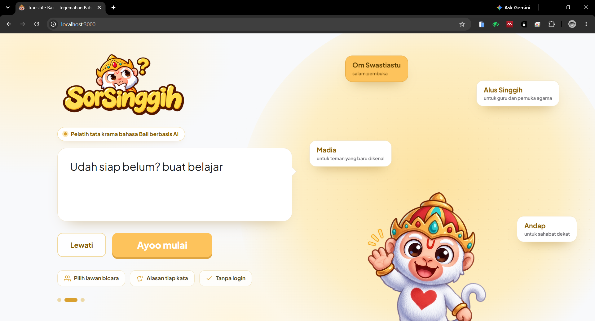 | 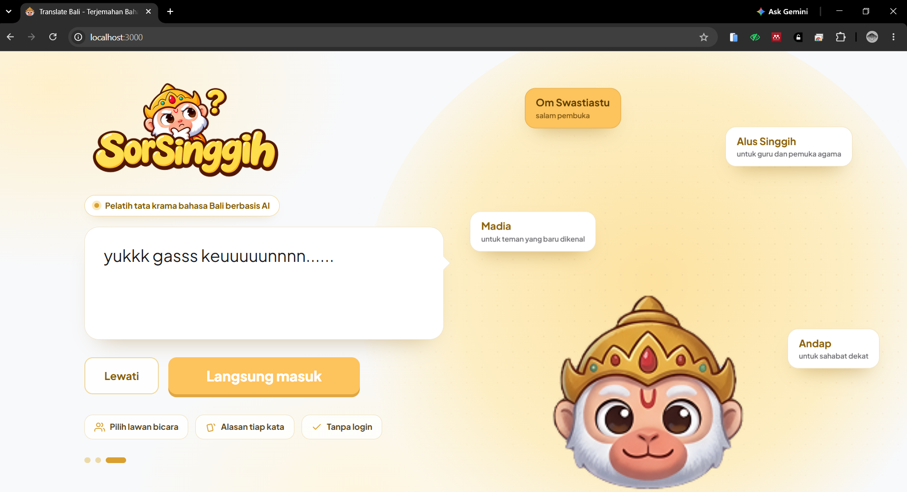 | 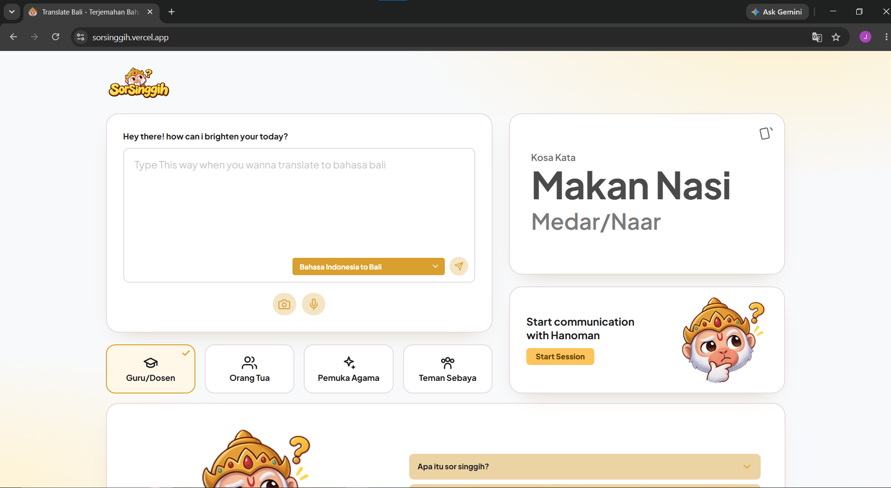 |

| Terjemah Teks | Terjemah Suara | Terjemah Kamera |
|:---:|:---:|:---:|
| 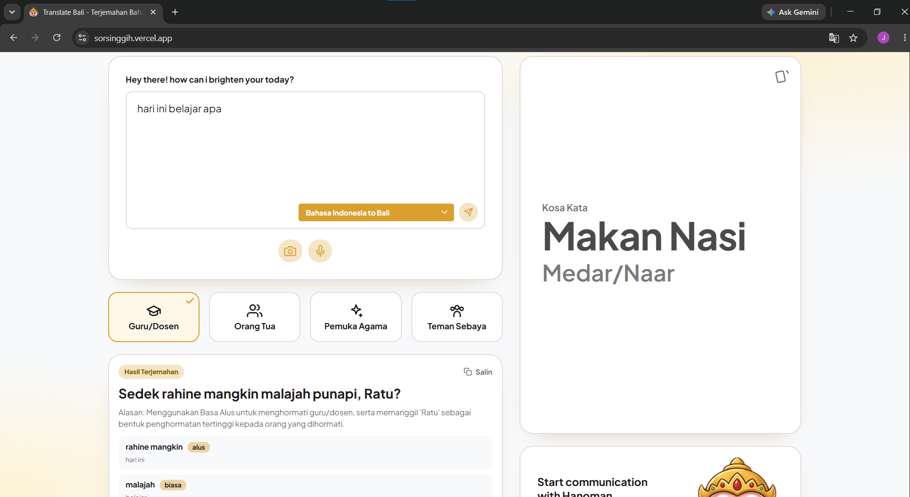 | 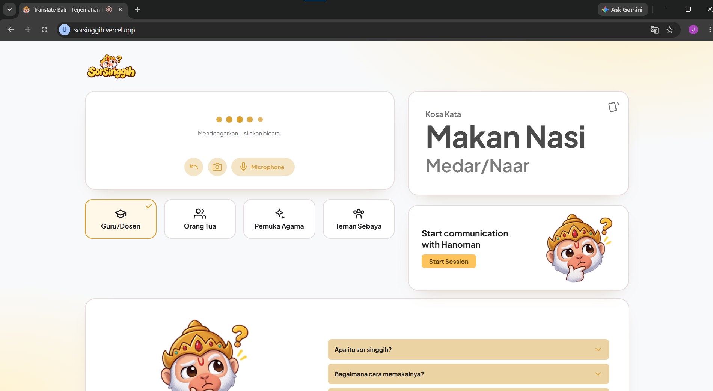 | 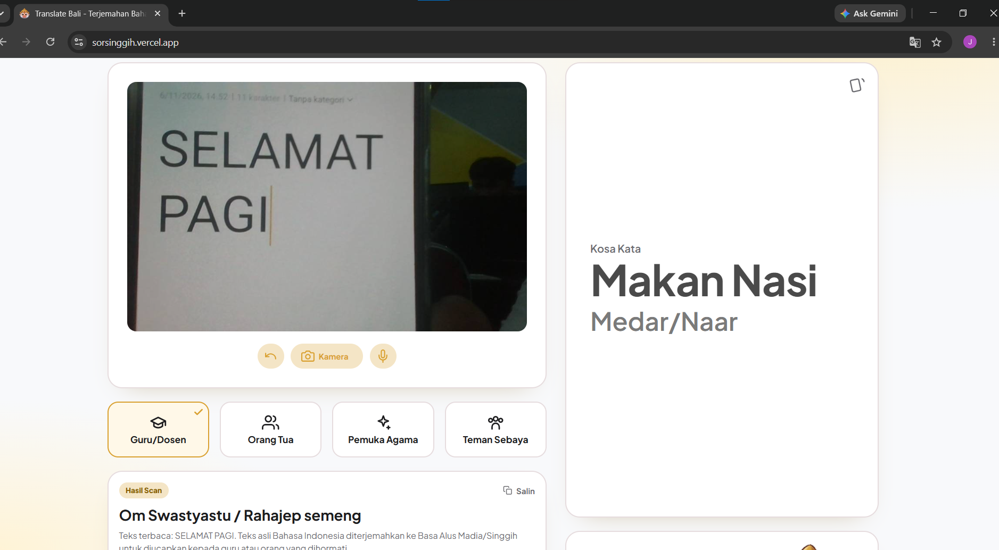 |

| Chat AI | FAQ |
|:---:|:---:|
| 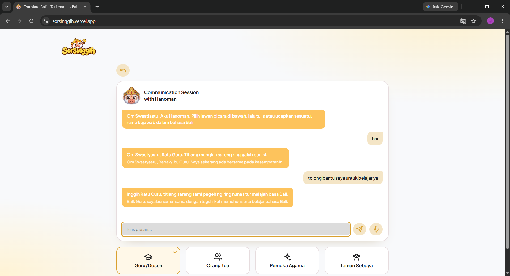 | 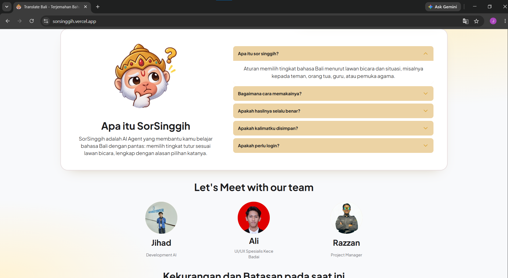 |

### Tampilan Mobile
| Welcome | Welcome 2 | Beranda |
|:---:|:---:|:---:|
| 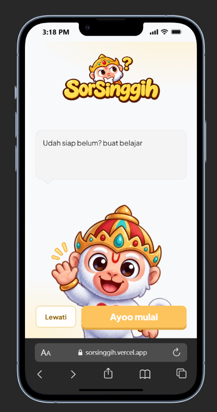 | 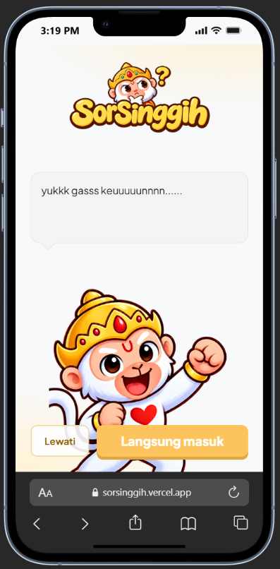 | 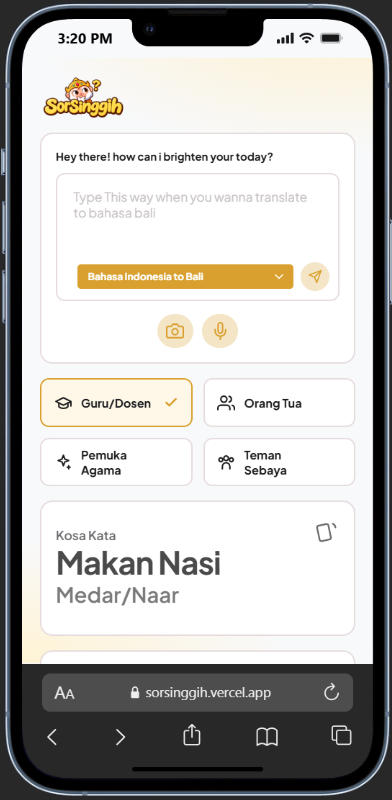 |

| Terjemah Teks | Terjemah Suara | Terjemah Kamera | Chat AI |
|:---:|:---:|:---:|:---:|
| 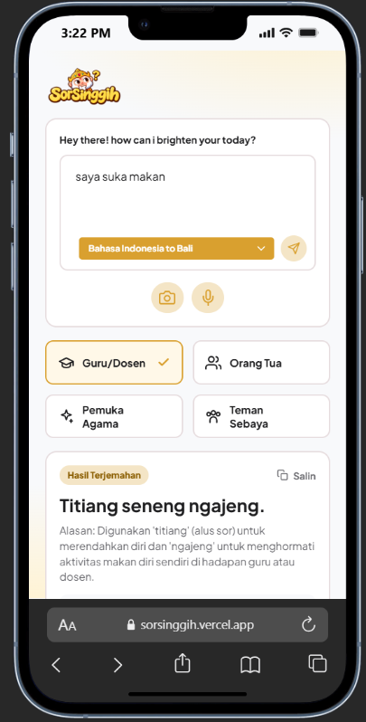 | 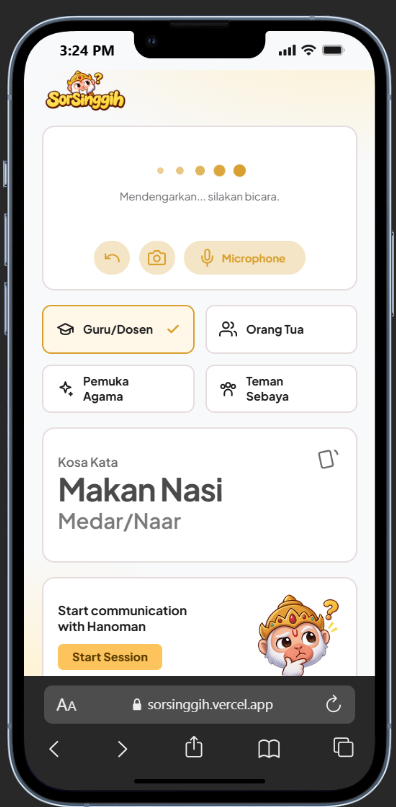 | 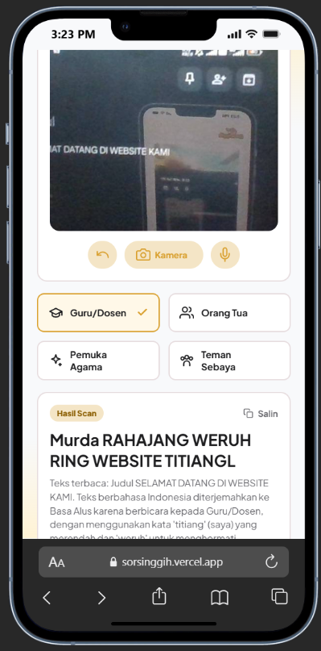 | 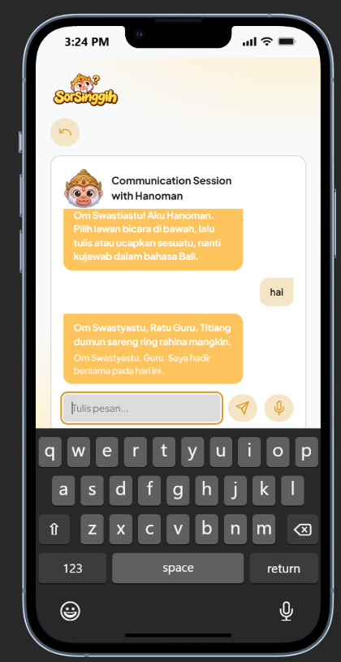 |

## Tech Stack
- Frontend: HTML, CSS, JavaScript (tanpa framework)
- Backend: Node.js dengan Express
- Database: belum ada. Akun dan progres belajar disimpan di localStorage browser
- Hosting: [Vercel / isi setelah deploy]

## AI Implementation
- Model: Google Gemini (`gemini-3.5-flash-lite`) lewat `@google/generative-ai`
- Fungsi: menerjemahkan Indo ke Bali sesuai tingkat tutur, mengartikan Bali ke Indo,
  dan mengoreksi kalimat Bali pengguna
- Input: kalimat dan profil lawan bicara. Output: JSON berisi hasil, alasan, dan rincian kata
- Pemanggilan AI hanya terjadi di server (`server.js`), kunci API tidak pernah dikirim ke browser

## Architecture / Data Flow
Browser -> Express (/api/ubah, /api/pahami, /api/koreksi) -> Gemini API -> JSON -> Browser
Kalimat pengguna tidak disimpan di server.

## Run Instructions
1. Pasang Node.js versi 18 atau lebih baru
2. `npm install`
3. Salin `.env.example` menjadi `.env`, isi `GEMINI_API_KEY`
4. `node server.js`
5. Buka http://localhost:3000

## Deployment URL
https://sorsinggih.vercel.app/

## Team Members
- Jihad Al Qudsi: Developer
- Ali Akbar Jendral Nusantara: UI/UX
- Razzan Ichlasul Amal: Project Manager

## Known Limitations
- Hasil AI dapat keliru dan belum divalidasi penutur asli
- Belum ada penanda tingkat keyakinan dan tombol umpan balik penutur
- Suara memakai bahasa Indonesia, sehingga ucapan Bali bisa salah terbaca
- Akun hanya tersimpan di browser dan bukan autentikasi sungguhan
- Batas 20 permintaan per menit per pengguna, bergantung pada kuota Gemini

## Third-party Resources / Credits
- Library: express, cors, dotenv, @google/generative-ai
- Font: Plus Jakarta Sans (Google Fonts, lisensi OFL)
- Layanan: Google Gemini API
- Maskot (mascot.svg): [isi pembuat dan lisensinya]
- Detail lengkap: lihat [DISCLOSURE.md](DISCLOSURE.md)